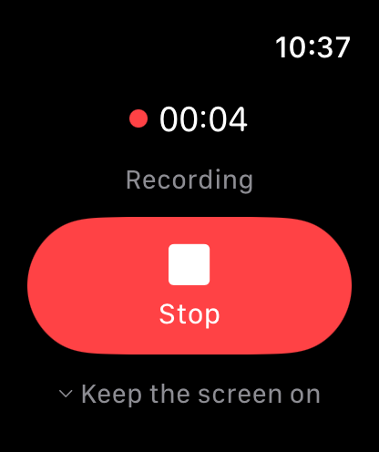
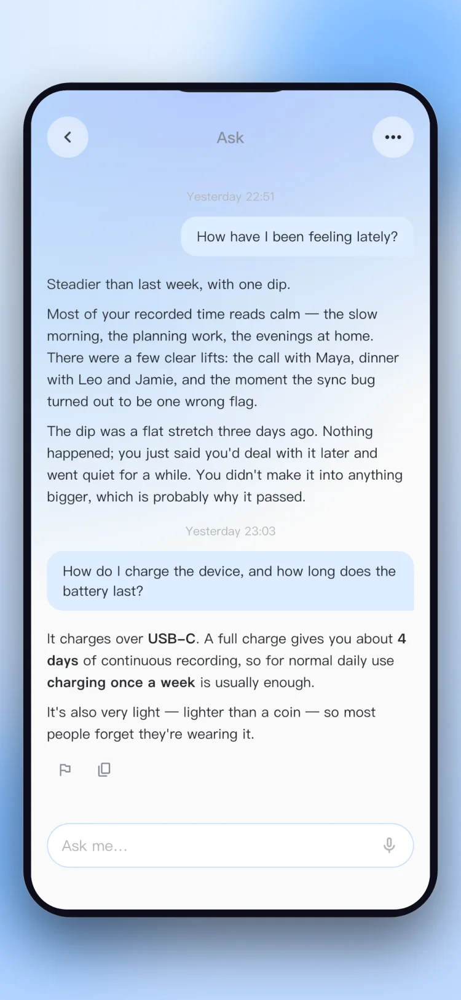
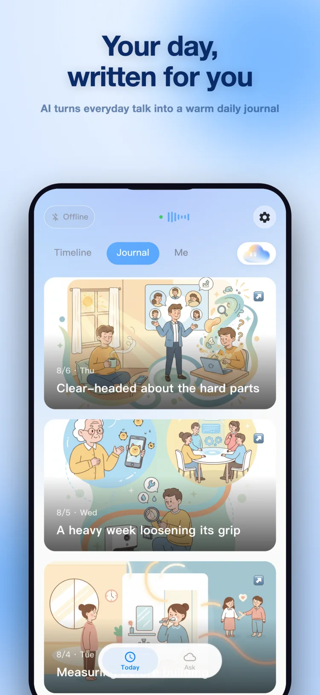
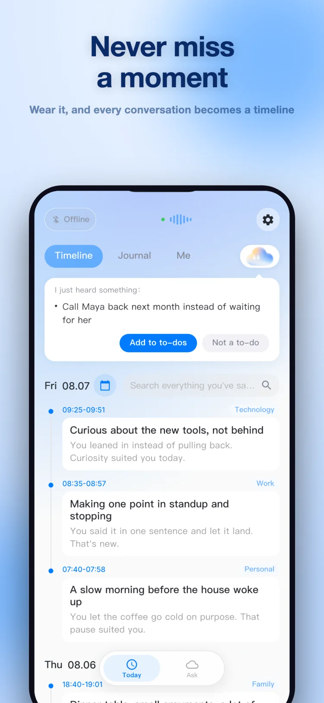
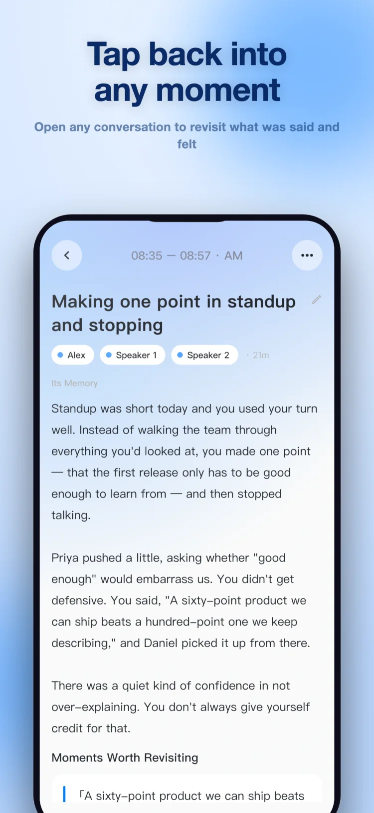
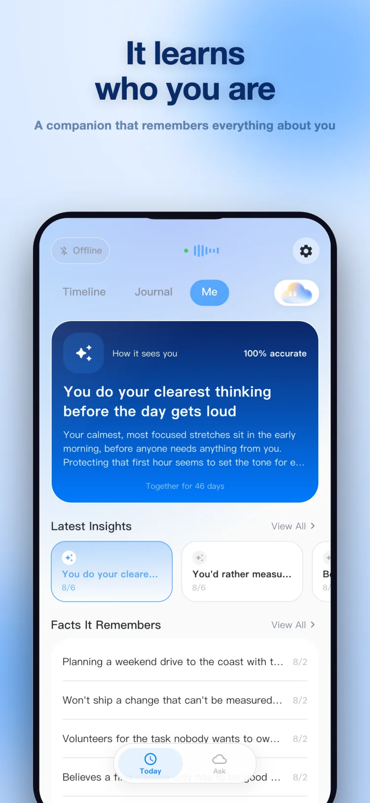

# Memorion

[简体中文](README.zh-CN.md) · [Website](https://memorion.me/) · [App Store](https://apps.apple.com/us/app/memorion-ai-voice-recorder/id6758304534) · [Developer setup](docs/development.md)

**Memorion is an open-source wearable AI platform for turning everyday conversations into searchable memory.** Record on iPhone or Apple Watch, or import audio from a compatible wearable. Then revisit what was said, ask follow-up questions, and see the day come together in your journal.

## Record on Apple Watch

Start and stop a recording from your wrist, even when your iPhone is out of reach. The watch app syncs the recording to your paired iPhone for transcription and AI processing. Review the transcript, summary, and timeline on iPhone after processing. All you need to start is the Memorion app and your paired Apple Watch. [See the Apple Watch walkthrough](https://memorion.me/en/app).

## From conversation to memory

### Transcription and speaker recognition

- **Real-time transcription and offline recording.** Stream audio for live transcription while connected, or record offline on a compatible device and have the recording transcribed after it syncs.
- **Speaker diarization and voiceprint recognition.** See who spoke when and match speakers against saved voice profiles. You can add names, correct speaker labels, and tap a transcript line to replay the matching audio when the recording is available.

### Conversation summaries, to-dos, and memories

- **LLM-assisted filtering.** Rules and an LLM help keep low-information snippets and media playback out of your conversation timeline.
- **Conversation summaries.** Revisit the main points, decisions, and next steps without reading the full transcript.
- **To-do and memory extraction.** Review suggested follow-ups before adding them to your to-do list. Memorion also extracts facts and context you can search or ask about later.

### Conversation Chat and Ask

Ask a question from an individual chapter to follow up in context, such as “What did we agree to do next?” Use **Ask** to look across past conversations when you remember the topic but need help finding the moment. For example, ask what the team decided at last week’s product review, then return to the relevant conversation. [See more examples on the website](https://memorion.me/).

### Daily Journal

Memorion uses your conversations to create a dated journal entry. See what stood out across the day, what you want to remember, and what you want to pick up tomorrow. Browse older entries in the Journal tab, or switch to the conversation timeline for the full transcripts.

The hosted app uses cloud speech-to-text and AI services. A self-hosted installation sends data to the providers you configure. Record with the knowledge and consent of the people involved.

## iPhone screenshots

| Conversation Chat (Ask) | Daily Journal |
| :---: | :---: |
|  |  |

| Timeline | Conversation detail | Personal memory |
| :---: | :---: | :---: |
|  |  |  |

Screenshots from the [Memorion website](https://memorion.me/#apps).

## Use cases

- **Meeting notes.** Review decisions and open questions, then check the transcript before assigning follow-ups or sharing a recap.
- **Daily journaling and life logging.** Turn everyday conversations into dated entries and revisit a moment by topic even when you forget the date.
- **Everyday organization for people with ADHD.** Capture commitments as they come up in conversation, review suggested to-dos, and find your next step after switching tasks.
- **Personal knowledge bases for developers.** Use the CLI to retrieve transcripts and summaries as JSON for your own index, or connect an AI assistant through MCP to search your memories and find the source conversation. [CLI guide](https://memorion.me/en/docs/cli) · [MCP guide](https://memorion.me/en/docs/mcp)
- **Lectures and study sessions.** Ask about a concept you missed and use the transcript to check how it was explained.
- **User research interviews.** Summarize the main themes and replay a passage to check a quote in context.

## Recording sources

| Source | What is available |
| --- | --- |
| iPhone microphone | Start and stop recording in the app. No wearable is needed. |
| Apple Watch | Start and stop from the watch app. Audio syncs to the paired iPhone for processing. |
| soundcore Work (Anker D3200) | Import completed device recordings. |
| DingTalk A1 | Authorize the device and import completed recordings. Automatic sync is optional. |
| PLAUD Note | Authorize the original Note and sync completed recordings. The adapter supports Wi-Fi transfer. |
| ChipletRing BCL603 | Experimental iOS adapter in source for recording and audio sync. Device and firmware compatibility is limited. |
| Memorion DevKit / Omi, Brilliant Labs Frame | Development adapters in source. Omi and DevKit firmware projects are included. |

The App Store listing documents the first five recording sources. Memorion’s dedicated consumer recording hardware is coming soon.

## Inside the repository

The code covers the path from capturing audio on a phone or wearable to producing transcripts, chat responses, and journal entries.

| Layer | Where to start | What’s included |
| --- | --- | --- |
| Mobile app and device adapters | [`app/`](app/) · [Flutter source](app/lib/) | iOS and Android app source, recording and BLE device integrations, conversation timeline, Ask, and journal UI. |
| Apple Watch | [Watch app](app/ios/MemorionWatch/) · [Widgets](app/ios/MemorionWatchWidgets/) · [iPhone sync](app/ios/Runner/WatchSessionService.swift) | Native Swift recording app, watch controls, and audio transfer to the phone. |
| Backend and data | [`backend/`](backend/) · [API routes](backend/routers/) · [Data access](backend/database/) | FastAPI endpoints for audio ingestion, conversations, memories, and chat. |
| Speech and AI model layer | [Speech-to-text](backend/utils/stt/) · [LLM pipelines](backend/utils/llm/) · [Retrieval](backend/utils/retrieval/) · [Model routing](backend/config/README.md) | Speech provider adapters, prompts, embeddings and retrieval, model selection, and pipelines for summaries, chat, and journals. Configure the inference providers for your deployment. |
| Firmware | [`firmware/`](firmware/README.md) | Omi and DevKit embedded firmware, board presets, and build instructions. |
| Developer integrations | [CLI](cli/packages/cli/README.md) · [MCP server](cli/packages/mcp/README.md) | Use your Memorion recordings from scripts and AI assistants. |

Start with the [local development guide](docs/development.md) to configure your own backend and connect the app or developer tools.

## License

See the [MIT license](LICENSE) and [third-party notices](docs/third-party.md). The project builds on [Omi](https://github.com/BasedHardware/omi). Device names identify compatibility.
