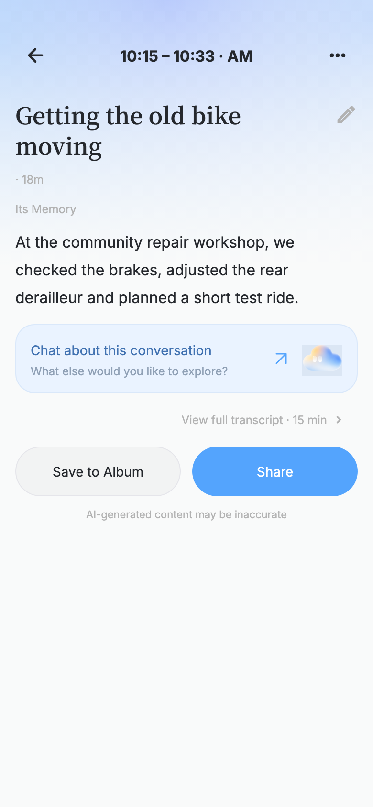

# Memorion

[简体中文](README.zh-CN.md) · [App Store](https://apps.apple.com/us/app/memorion-ai-voice-recorder/id6758304534) · [Developer setup](docs/development.md)

Memorion turns everyday conversations into a searchable timeline, notes and a daily journal. You can start a recording on your phone, use the Apple Watch companion, or import recordings from a compatible wearable. The repository contains the mobile app, processing backend, device adapters and firmware for developers building wearable AI.

## What you can do

- Record conversations, browse their transcripts and summaries, and tap a transcript line to hear the corresponding audio when a recording is available.
- Find past conversations in your timeline, name people and correct speaker labels.
- Review suggested to-dos, manage saved memories and revisit the day as a journal.
- Ask follow-up questions about a conversation or search across your memory with Ask.

The hosted app uses cloud speech-to-text and AI services. A self-hosted installation sends data to the providers you configure. Record with the knowledge and consent of the people involved.

| Conversation chapter | Daily journal |
| :---: | :---: |
|  |  |

Screenshots rendered from the Flutter app with fictional conversations.

## Recording sources

| Source | What is available |
| --- | --- |
| iPhone microphone | Start and stop recording in the app. No wearable is needed. |
| Apple Watch | Start and stop from the watch app. Audio syncs to the paired iPhone for processing. |
| soundcore Work (Anker D3200) | Import completed device recordings. |
| DingTalk A1 | Authorize the device and import completed recordings. Automatic sync is optional. |
| PLAUD Note | Authorize the original Note and sync completed recordings. The adapter supports Wi-Fi transfer. |
| ChipletRing BCL603 | Experimental iOS adapter in source for recording and audio sync. Device and firmware compatibility is limited. |
| Memorion DevKit / Omi, Brilliant Labs Frame | Development adapters in source. Omi and DevKit firmware projects are included. |

The App Store listing documents the first five recording sources. Memorion’s dedicated consumer recording hardware is coming soon.

## Repository layout

| Directory | Contents |
| --- | --- |
| [`app/`](app/) | Flutter app for iOS and Android, watchOS companion and BLE adapters |
| [`backend/`](backend/) | FastAPI, transcription, conversation processing and Developer API |
| [`cli/`](cli/README.md) | TypeScript CLI and MCP server |
| [`firmware/`](firmware/README.md) | Omi and DevKit firmware |
| [`docs/`](docs/) | Developer setup, API guide and screenshots |

Start with the [developer setup](docs/development.md). For API clients, see the [Developer API guide](docs/api/README.md).

## License

See the [MIT license](LICENSE) and [third-party notices](docs/third-party.md). The project builds on [Omi](https://github.com/BasedHardware/omi). Device names identify compatibility.
