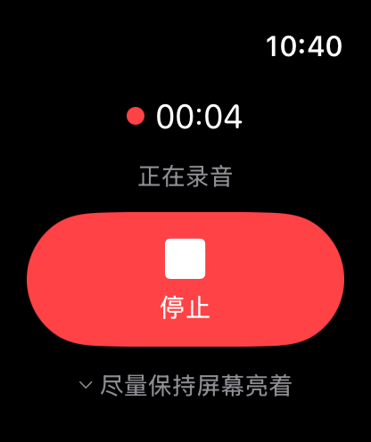
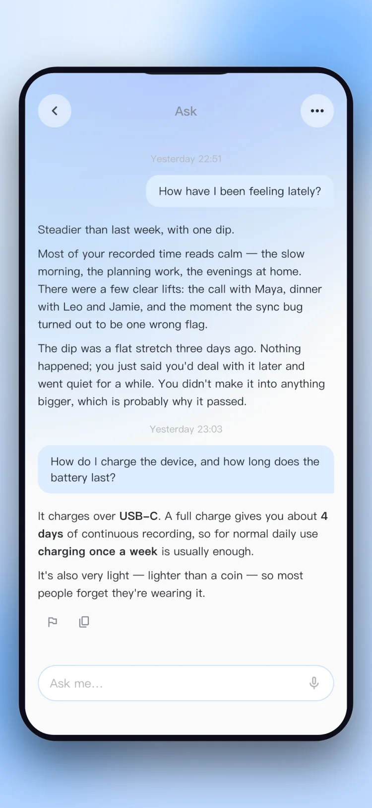
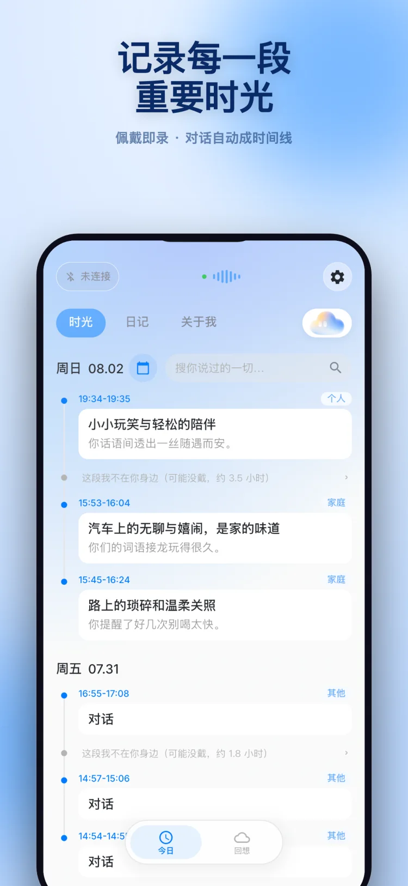
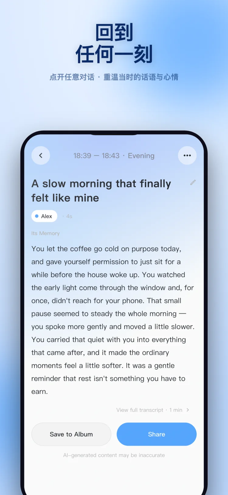

# Memorion

[English](README.md) · [官网](https://memorion.me/zh) · [App Store](https://apps.apple.com/us/app/memorion-ai-voice-recorder/id6758304534) · [开发环境搭建](docs/development.md)

**Memorion 是一个随身 AI 开源项目，把日常对话变成可搜索的个人记忆。** 用 iPhone 或 Apple Watch 录音，也可以从兼容设备导入。录完后可以回听、追问，还能在日记里回顾这一天。

## 用 Apple Watch 开始录音

iPhone 不在手边时，也可以直接在手腕上开始和停止录音。手表会把音频同步到配对的 iPhone，再交给后端转写和处理。处理完成后，在 iPhone 上就能查看转写、摘要和时间线。有 Apple Watch 和配对的 iPhone 就能开始。[查看官网的 Apple Watch 使用流程](https://memorion.me/zh/app)。

## 从一段对话到一天的记忆

### 对话与转写

打开一段对话，可以回顾转写、摘要和重点内容，也可以为参与者添加姓名、修正说话人标注。有原录音时，点按任意一句转写即可回听对应片段。对话里提到的后续事项会作为建议待办出现，确认后可加入清单。

### 对话问答（Conversation Chat）与全局 Ask

从一段对话里继续追问，例如“我们最后决定下一步做什么？”只记得聊过的话题时，可以用 **Ask** 跨对话查找，例如查找上周产品评审定下的下一步，再回到相关对话查看上下文。[查看官网的更多问答示例](https://memorion.me/zh)。

### 每日日记（Daily Journal）

Memorion 会根据当天的对话生成带日期的日记，整理今天值得记下的事和明天想继续做的事。在日记页可以回顾以前的条目，需要完整转写时可以切回对话时间线。

托管版使用云端转写和 AI 服务。自建版会使用你配置的处理服务。开始录音前请让在场人员知情并同意。

## iPhone 应用截图

| 对话问答（Ask） | 每日日记 |
| :---: | :---: |
|  |  |

| 对话时间线 | 对话详情 |
| :---: | :---: |
|  |  |

截图来自 [Memorion 官网](https://memorion.me/zh#apps)。

## 支持的录音来源

| 来源 | 当前能力 |
| --- | --- |
| iPhone 麦克风 | 手动开始和停止录音，无需额外设备。 |
| Apple Watch | 在手表端开始和停止，录音同步到配对的 iPhone 后处理。 |
| 安克录音豆 soundcore Work（D3200） | 导入设备已经完成的录音。 |
| 钉钉 A1 | 设备授权后导入已完成的录音，可选自动同步。 |
| PLAUD Note | 授权并同步原版 Note 上已完成的录音，适配器支持 Wi-Fi 传输。 |
| ChipletRing BCL603 | 源码中的 iOS 实验性适配，包含录音和音频同步。适用范围取决于型号和固件。 |
| Memorion DevKit / Omi、Brilliant Labs Frame | 仓库包含开发用适配器，以及 Omi 和 DevKit 固件项目。 |

表中前五项已列入 App Store 版本说明。Memorion 自有消费版录音硬件尚未开放。

## 仓库里有什么

从手机或可穿戴设备采集音频，到转写、问答和生成日记，这个仓库包含整条链路的代码。

| 层级 | 代码入口 | 包含内容 |
| --- | --- | --- |
| 移动端与设备适配 | [`app/`](app/) · [Flutter 源码](app/lib/) | iOS 和 Android 应用源码、录音和 BLE 设备集成、对话时间线、Ask 和日记界面。 |
| Apple Watch | [手表应用](app/ios/MemorionWatch/) · [小组件](app/ios/MemorionWatchWidgets/) · [iPhone 同步](app/ios/Runner/WatchSessionService.swift) | 原生 Swift 录音应用、手表录音控件和音频同步。 |
| 后端与数据 | [`backend/`](backend/) · [API 路由](backend/routers/) · [数据访问](backend/database/) | 音频接收、对话、记忆和问答的 FastAPI 实现。 |
| 语音与 AI 模型层 | [语音转写](backend/utils/stt/) · [LLM 流程](backend/utils/llm/) · [检索](backend/utils/retrieval/) · [模型路由](backend/config/README.md) | 转写服务适配、提示词、向量与检索、模型选择，以及摘要、问答和日记生成流程。自建时可配置使用的推理服务。 |
| 固件 | [`firmware/`](firmware/README.md) | Omi 和 DevKit 的嵌入式固件、板卡配置与编译说明。 |
| 开发者集成 | [CLI](cli/packages/cli/README.md) · [MCP 服务器](cli/packages/mcp/README.md) | 在脚本或 AI 助手中访问自己的 Memorion 录音。 |

从[本地开发指南](docs/development.md)开始，配置自己的后端并接入 App 或开发者工具。

## 许可

见 [MIT 许可证](LICENSE)和[第三方许可说明](docs/third-party.md)。项目基于 [Omi](https://github.com/BasedHardware/omi)，设备名称用于标明兼容性。
